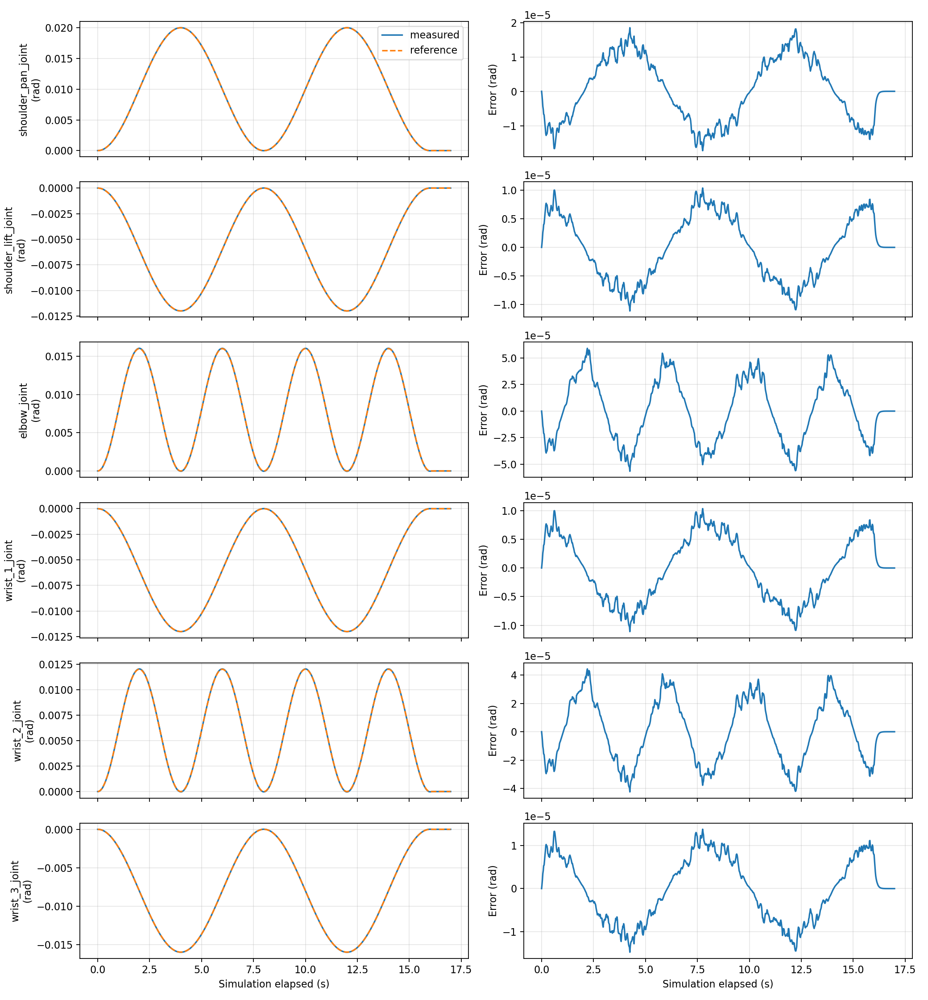
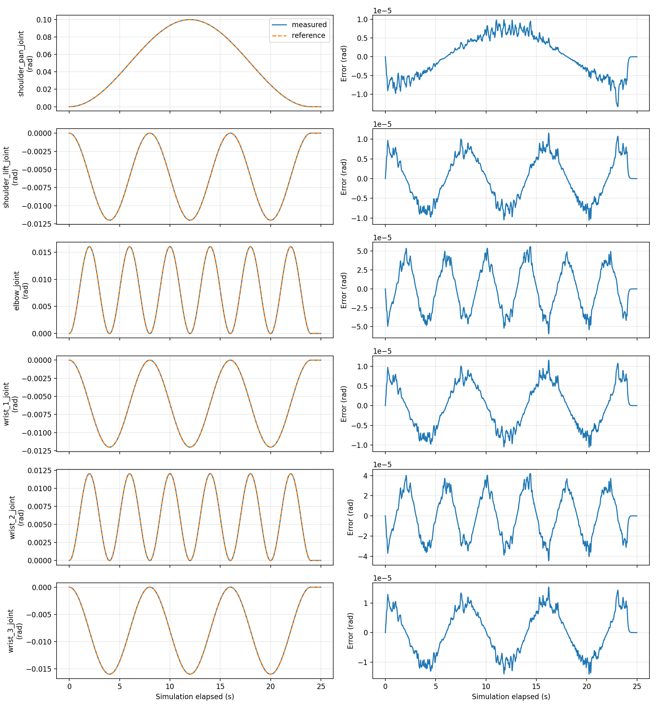

# P2 基于 ROS2 与 Gazebo 的 UR5e 六关节运动学 MPC

在 P1 的轨迹执行实验基础上，使用关节速度接口实现运动学模型预测控制，与“参考速度前馈＋位置 P”基线比较，并验证独立保护节点、计算异常回退和运动中请求断流后的停止处理。

本项目只用于 Gazebo 仿真，不适用于直接控制实机。六关节使用独立积分器模型，不是机械臂耦合动力学、力矩控制、末端路径规划或连续避障。

## 官方组件与本人增加

官方工程提供 UR5e 的 URDF/碰撞网格、Gazebo 仿真、ros2_control 接口、关节状态广播器和速度控制器。UR MoveIt 配置提供自碰撞排除表，本项目没有运行 MoveIt 规划服务。

在这些组件上增加：

- OSQP 二次规划实现的关节空间 MPC，六关节共 150 个预测速度变量。
- 参考速度前馈＋位置 P 基线，与 MPC 使用相同参考、接口和约束。
- 速度、速度指令变化率、预测位置与相对位移约束。
- 独立请求保护进程及独立网格碰撞计算进程，按最新状态覆盖待检查姿态。
- 反馈/请求新鲜度检查、连续静止验证、受控求解异常与超时回退。
- 自动执行、日志、逐关节图、三次重复对比、离线指标复核与源码快照。

这是速度层控制实验，底层速度控制器和仿真硬件接口不是本人实现。

## 已验证环境

- Ubuntu 22.04、ROS2 Humble、Python 3.10，VMware 约 4 CPU / 8 GB。
- Gazebo Sim 6 / Fortress，核心库版本 6.18.0；RViz 在正式重复实验中关闭以降低负载，Gazebo GUI 保留。
- NumPy 1.21.5、SciPy 1.8.0、OSQP 1.0.4、Matplotlib 3.5.1。
- python-fcl 0.7.0.8、trimesh 4.5.3。
- 官方仿真依赖沿用 [P1 的 dependencies.repos](../P1/dependencies.repos)。

P2 Python 依赖版本见 [requirements_p2_six.txt](scripts/requirements_p2_six.txt)。这不是完整系统锁文件；尚未从全新机器独立复现。

## 原理与接口

模型为 `q(k+1) = q(k) + 0.02 u(k)`，q/u 均为六维关节角/速度。Np=Nc=25，预测约 0.5 秒；每次求解后只执行第一步，再按最新反馈重算。模型和代价可按关节分解，一次联合求解不代表动力学耦合建模。

代价包括位置误差、与参考速度的差、相邻速度指令差，权重为 100 / 1 / 0.1。基线使用 `u = v_ref + 2(q_ref-q)`。MPC使用未来参考，基线使用当前参考及解析速度前馈，比较需明确此差异。

```text
/joint_states → 跟踪节点 → /p2/six_joint_velocity_request
                              ↓
                     独立保护节点 ← 独立碰撞计算进程
                              ↓
              /forward_velocity_controller/commands → Gazebo
```

控制器仅 `joint_state_broadcaster` 和 `forward_velocity_controller` 为 active。请求类型为 `sensor_msgs/JointState`，关节顺序固定，header 使用反馈仿真戳；底层命令为六维 `Float64MultiArray`。不要同时运行 P1 轨迹任务、旧单关节保护或其他速度发布程序。

## 目录

```text
P2/
├── README.md
├── docs/                       原理、操作、结果与复现说明
├── scripts/                    离线、自动实验与复核入口
├── ros2_ws/src/ur5e_mpc_control/
├── experiments/                小幅版/演示版源码快照与哈希
├── evidence/                   正式批次的压缩原始日志
├── results/                    重新核算的逐次指标、汇总与验收
└── figures/portfolio/          代表性图
```

本地 data_v1～v3 记录开发过程，data_v4 为六关节小幅实验，data_v5 为演示。Git只收录选定正式批次的压缩证据；本地失败日志不删除，但未把全部开发数据上传。build/install/log、.venv、缓存和重复图片不上传。

## 运行

以下均在 Ubuntu 执行，假设 P1 官方依赖已经构建。首次获取代码先按 [复现说明](docs/REPRODUCIBILITY.md) 建立虚拟环境并安装依赖。

### 终端 A：启动一套仿真

```bash
source /opt/ros/humble/setup.bash
source ~/ROS2/arm/P1/ros2_ws/install/setup.bash
cd ~/ROS2/arm/P2/ros2_ws
colcon build --packages-select ur5e_mpc_control --symlink-install
source install/setup.bash
env -u WAYLAND_DISPLAY LIBGL_DRI3_DISABLE=1 ros2 launch ur5e_mpc_control p2_sim.launch.py
```

保持继续状态，不重复启动同一世界。可在实验开始前关闭 RViz 以降低负载，保持同一批次的显示条件不变。仿真时间与墙钟时间不同，GUI显示正常不能替代控制和反馈检查。

### 终端 B：检查与自动实验

```bash
source /opt/ros/humble/setup.bash
source ~/ROS2/arm/P1/ros2_ws/install/setup.bash
source ~/ROS2/arm/P2/ros2_ws/install/setup.bash
source ~/ROS2/arm/P2/.venv/bin/activate
cd ~/ROS2/arm/P2
python scripts/run_p2_six_module.py --mode preflight
```

只读模型和状态、检查静止/限位/采样路径，不发布速度。

预检查通过后，选择一个命令运行，不并发：

```bash
python scripts/run_p2_six_module.py --mode compare --repeats 1
python scripts/run_p2_six_module.py --mode all --repeats 3
python scripts/run_p2_six_module.py --mode demo
```

三个命令分别表示：基线/MPC各一次；三轮交替顺序对比加三项异常测试；第一关节约 5.73° 演示。脚本自动预检查、管理保护节点、验证最终静止，用户无需另开保护终端。`all` 最后会主动终止请求进程以测试断流，停在中途是预期行为。

失败时保留批次目录并读 case.json、guard.txt、tracking.txt，不通过放宽超时阈值强行运行。若停止未确认或子进程无法退出，在终端 A 用 Ctrl+C 结束仿真。保护节点自身崩溃仍无独立兜底。

## 已验证结果

正式小幅批次：`20261031_020227_994815_six_joint_batch`，六次跟踪加三项异常测试全部通过，正常 MPC 无回退。三次均值如下；样本标准差、逐次结果和 IAE 见 [结果报告](docs/RESULTS.md) 与 [CSV](results/joint_comparison_summary.csv)。

| 关节 | 基线 RMSE(rad) | MPC RMSE(rad) | 降低 |
|---|---:|---:|---:|
| shoulder_pan | 5.764e-5 | 9.196e-6 | 84.0% |
| shoulder_lift | 3.458e-5 | 5.518e-6 | 84.0% |
| elbow | 1.605e-4 | 2.913e-5 | 81.9% |
| wrist_1 | 3.458e-5 | 5.518e-6 | 84.0% |
| wrist_2 | 1.204e-4 | 2.185e-5 | 81.9% |
| wrist_3 | 4.611e-5 | 7.357e-6 | 84.0% |



单次求解异常、人工约 25ms 延迟均只触发一次回退，下一周期恢复；请求退出后检出请求戳过期并确认静止。后者最后接受请求到首次收尾发零约 246ms，不是精确的“杀进程到机械停止”时间。

大幅批次：`20261031_022029_568481_six_joint_batch`。第一关节实际偏移 0.100006rad（约 5.73°），约 25 秒仿真记录，最大实际速度 0.013092rad/s，无回退、静止验证通过。它改变了幅度和周期，仅作展示，不并入小幅重复实验统计。



## 数据、版本与指标依据

- [实验索引](experiments/README.md)：源码快照、配置及批次对应关系。
- [压缩原始记录与校验值](evidence/README.md)：保留全部正式子运行、模型快照、日志、图片和失败状态语义。
- [结果报告](docs/RESULTS.md)：指标口径、异常验收、局限和开发失败说明。
- [复现说明](docs/REPRODUCIBILITY.md)：环境、历史版本及离线核算。

可在不启动ROS2/Gazebo的情况下复核已发布证据：

```bash
python3 scripts/analyze_portfolio.py
```

程序直接读取压缩包，不解压执行其中代码，核对快照哈希、速度/请求变化率、状态和回退，重新计算 RMSE/IAE。历史运行时工作区未提交；日志中的旧Git提交号不能单独代表实际运行源码。本次保留匹配哈希的快照，后续Git提交是发布整理版本，不倒填为历史执行版本。

## 限制

- 只有仿真，无实机、力矩控制、负载扰动、末端精度或抓取验证。
- 六维积分模型忽略动力学，固定20ms预测与实际更新抖动存在偏差；不是硬实时系统。
- 碰撞检查是离散采样，仅支持原点安装机器人与水平地面，排除SRDF禁用对；没有连续扫掠体保证或动态障碍跟踪。
- 新鲜度以接收墙钟和仿真戳检查，不等于源消息绝对年龄。紧急发零绕过变化率限制，不保证物理加速度。
- 基线未系统调参；三次重复是本条件下的观察，不代表统计显著性、全局最优或工业可靠性。
- 开发中发生过反馈间隔和碰撞结果过期；保留记录并披露，最终通过不代表从无失败。
