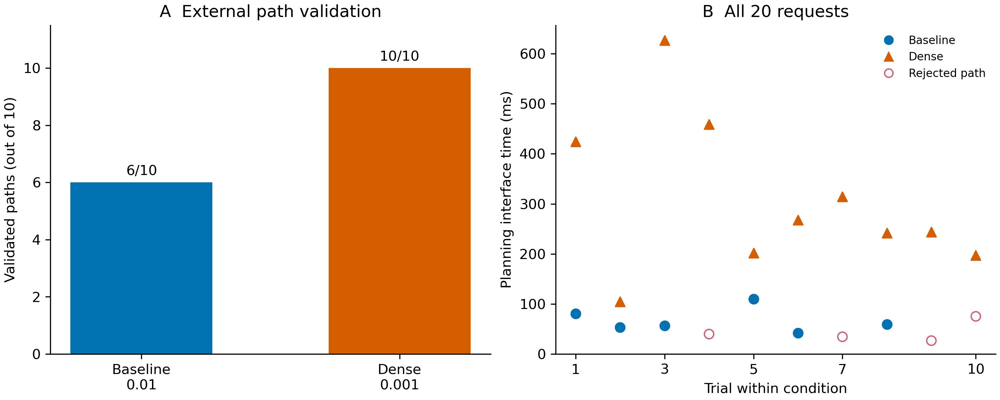
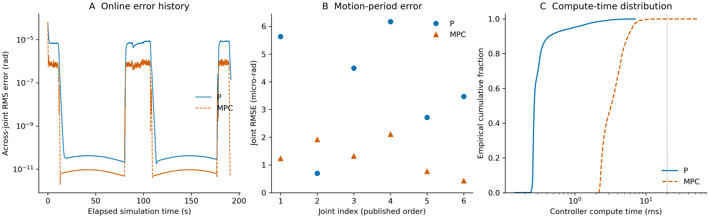

# P3：UR5e 障碍场景运动规划与仿真评测

基于 ROS2 Humble、MoveIt 2 与 Gazebo，完成 UR5e 的带时间戳坐标变换、双端障碍场景核查、绕障规划、轨迹校验与仿真执行，并记录异常处理和参数对照实验。

已完成规划与绕障执行，以及参考速度前馈＋位置 P 和运动学 MPC 的同轨迹离线与 Gazebo 开发对比。尚未完成干净环境复现验收与发布整理，P1、P2 保持独立。

## 环境与系统链路

- Ubuntu 22.04 虚拟机、ROS2 Humble、Python 3.10、Gazebo Fortress（Gazebo Sim 6）、MoveIt 2。
- Gazebo 提供物理仿真与关节反馈；MoveIt OMPL/RRTConnect 规划；joint_trajectory_controller 执行带时间的关节轨迹；RViz 显示规划与场景。
- 规划组 ur_manipulator，SRDF 链 base_link → tool0；模型根为 world，任务显式使用 world。未通过 MoveGroupInterface::getPlanningFrame() 独立核查。
- ROS 仿真节点使用 /clock。Gazebo 与 MoveIt 的箱体分别建模并查询验证；同名 world 不代表自动同步。

## 已完成与边界

| 项目 | 结果 |
|---|---|
| TF2 | PointStamped/PoseStamped 在 tool0 与 world 间同时间戳往返转换；缺失 frame 和未来时间外推诊断 |
| 位姿目标 | FK 构造可达测试目标，IK、状态有效性、规划与终点 FK 校验；保留初始 IK 失败记录 |
| 障碍场景 | 核对 Gazebo 与 MoveIt 箱体中心、朝向、尺寸及显式坐标映射 |
| 绕障案例 | 起终点有效，直接关节插值碰撞；保存绕障轨迹并执行通过 |
| 控制器插值 | 对保存轨迹统一时间缩放，检查五次样条数值极值及离散碰撞样本 |
| 异常与取消 | 负例处理通过；控制器 Action 取消、终态及反馈停稳通过；MoveIt ExecuteTrajectory 取消超时仍未解决 |
| 重复评测 | 首批 10 次校验通过 7 次；参数对照原配置 6/10，加密配置 10/10 |
| 同轨迹跟踪 | P/MPC 离线四组与 Gazebo 各一次完整运行通过；在线 MPC 存在 3 次计算超预算退化 |

以上均为仿真结果。离散采样通过不等于连续碰撞保证；模型 FK 误差不代表实机定位精度；Action 取消不是独立急停系统。批量规划未执行运动。

## 参数对照结果

同一固定场景、起终点与外部校验标准，先原配置 10 次，再加密配置 10 次，无失败补跑。仅改变 OMPL longest_valid_segment_fraction。

| 指标 | 原配置 0.01 | 加密配置 0.001 |
|---|---:|---:|
| 规划返回成功 | 7/10 | 10/10 |
| 外部路径采样校验通过 | 6/10 | 10/10 |
| 通过项规划接口耗时中位数 | 0.0575 s | 0.2554 s |
| 通过项关节空间路径长度中位数 | 6.514 rad | 6.136 rad |
| 通过项计划运动时长中位数 | 13.47 s | 15.35 s |

本批加密组通过率更高，耗时中位数约为原组的 4.44 倍。耗时和路径指标只统计各组通过项，样本群体不同。每组 10 次、无配对随机种子且存在组别顺序效应，属于探索性实验，不宣称统计显著或普遍可靠性。参数读回已验证，内部实际检查密度未做源码级测量。实验结束已恢复原参数 0.01。

## 目录与证据

- scripts/：TF、场景、规划、保存轨迹校验、执行、异常测试和批次评测脚本。
- config/：版本化测试配置。
- ros2_ws/src/ur5e_planning_eval/：固定绕障案例搜索与离线样条碰撞检查工具。
- evidence/tf/、data/runs/：本地原始证据，不保证随源码发布。
- [TF 实践记录](docs/frames_and_tf.md)、[评测说明](docs/evaluation_report.md)、[证据索引](docs/evidence_index.md)。
- [Gazebo 同轨迹对比](docs/gazebo_tracking_results.md)：时间加权 RMSE 为 P 4.2571e-6 rad、MPC 1.3370e-6 rad，本次降低约 68.6%；两次起点有差异、各仅一次运行，不宣称实机精度或普遍优势。
- [演示视频索引](media/README.md)：录屏副本已本地归档，未公开上传；视频与执行日志的精确对应尚未逐帧核实。

## 结果图与复现说明





图注、源数据哈希与样本口径见 results/figures/figure_metadata.json。在线各一次运行，无统计显著性推断；图中极小误差不代表实机精度。

[复现依赖与已知问题](REPRODUCIBILITY.md)。results/source 保留精简报告和图表源数据；原始 data/evidence 不默认加入 Git；[典型失败与验收案例](results/cases/README.md)可直接浏览。

## 运行入口

以下为已有环境中的人工操作入口，不包含依赖安装。新机器需核对 UR 仿真、UR MoveIt 配置及本项目工具包；完整依赖与干净环境复现验收尚未完成。

终端 A：Gazebo，避免重复启动仿真。

```bash
source /opt/ros/humble/setup.bash
source ~/ROS2/arm/P1/ros2_ws/install/setup.bash
env -u WAYLAND_DISPLAY LIBGL_DRI3_DISABLE=1 \
  ros2 launch ur_simulation_gz ur_sim_control.launch.py \
  ur_type:=ur5e initial_joint_controller:=joint_trajectory_controller \
  start_joint_controller:=true launch_rviz:=false
```

终端 B：MoveIt 与 RViz。

```bash
source /opt/ros/humble/setup.bash
source ~/ROS2/arm/P1/ros2_ws/install/setup.bash
env -u WAYLAND_DISPLAY LIBGL_DRI3_DISABLE=1 \
  ros2 launch ur_moveit_config ur_moveit.launch.py \
  ur_type:=ur5e use_sim_time:=true launch_rviz:=true launch_servo:=false
```

终端 C：按已验收模块执行脚本。规划不等于执行；任何旧轨迹再次发送前都需核对实际起点、场景、模型和控制器。取消后机器人留在中途，不能重发旧轨迹。

对照实验入口（需要原始固定案例证据和现有场景；不执行运动，临时改参数并尝试恢复）：

```bash
source /opt/ros/humble/setup.bash
source ~/ROS2/arm/P1/ros2_ws/install/setup.bash
cd ~/ROS2/arm/P3
python3 scripts/run_resolution_comparison.py \
  --case-dir data/runs/20261101_224558+0800_detour_search_wELTEptP \
  --config config/detour_plan_v1.json --run
```

异常退出后须核查 parameter_restored，不能假设强制终止时也已恢复参数。

## 后续工作

1. 解决 MoveIt ExecuteTrajectory 取消超时，保留现有失败证据。
2. 固化加密配置的启动方式，并补充干净环境复现与更多重复实验。
3. 扩充已完成的同轨迹跟踪对比，增加配对重复与扰动测试；目前 Gazebo 每控制器一次完整通过，不能当作统计可靠性结论。
4. 源码与精选数据通过 Git 管理；视频与完整原始证据使用单独的 Release 附件，具体发布状态见 media/README.md。
